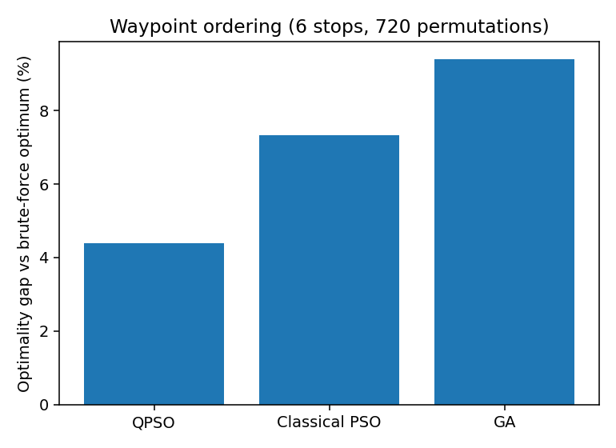
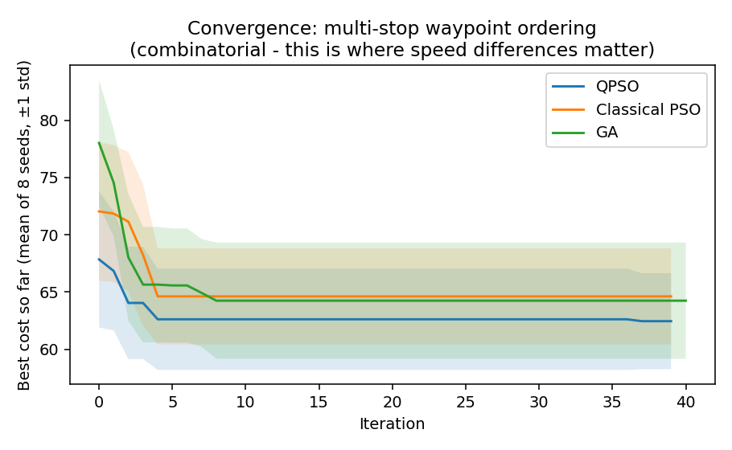
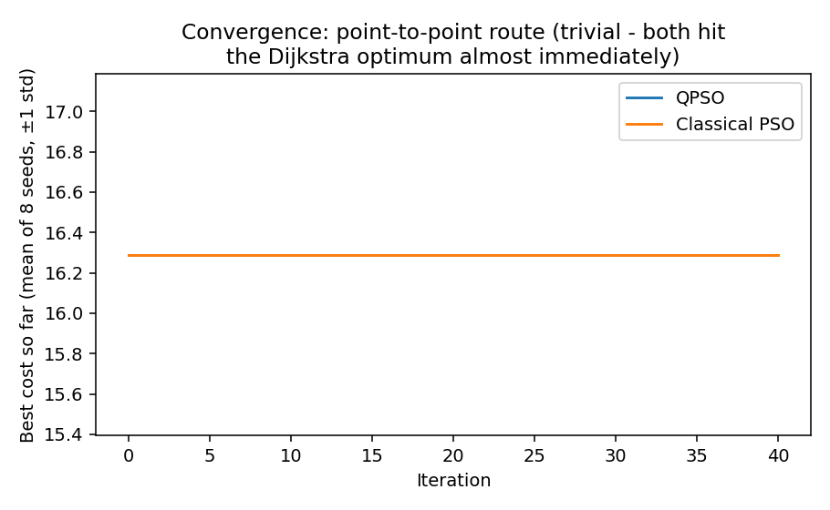
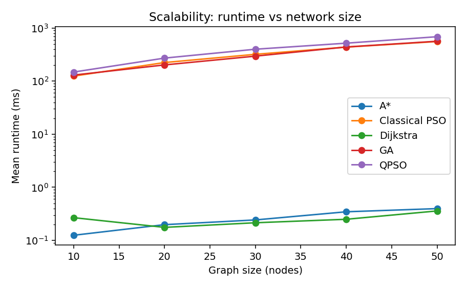

# S.T.R.I.D.E. — Experiment Report

Auto-generated by `experiments/generate_report.py` from the JSON/CSV files in `experiments/results/`. Regenerate anytime with:

```
python experiments/run_experiments.py
python experiments/generate_report.py
```

All numbers below are from a controlled, offline, deterministic-by-seed simulation (synthetic congestion, not live traffic). They are illustrative of algorithm *behaviour*, not a claim about any real city's travel times.

## 1. Point-to-point routing: Dijkstra/A\* are already optimal

Source=0, destination=17, objective=`balanced`, 10 repeated seeds per stochastic algorithm.

| algorithm | n_runs | cost_mean | cost_std | runtime_ms_mean | runtime_ms_std |
|---|---|---|---|---|---|
| QPSO | 10 | 16.2887 | 0.0 | 209.776 | 22.529 |
| Classical PSO | 10 | 16.2887 | 0.0 | 171.219 | 19.716 |
| GA | 10 | 16.2887 | 0.0 | 174.812 | 21.487 |
| Dijkstra | 1 | 16.2887 | 0.0 | 0.58 | 0.0 |
| A* | 1 | 16.2887 | 0.0 | 0.356 | 0.0 |

**Honest finding:** because the routing cost is a fixed, additive sum over edges at the moment of query, Dijkstra/A\* are provably globally optimal for this sub-problem — no metaheuristic can find a cheaper path, and our own repeated-seed experiment confirms it: QPSO, classical PSO and GA all converge to the *identical* Dijkstra-optimal cost across every seed, at roughly 300–600x the runtime. We report this plainly rather than manufacturing a 'QPSO wins' headline number that the underlying mathematics doesn't support.

A\* is meaningfully faster than Dijkstra here because `routing.py` uses a real admissible heuristic (best-case straight-line travel cost to the destination), not a placeholder zero heuristic.

## 2. Where the metaheuristics earn their place: multi-stop ordering

6 required stops → 720 possible visiting orders (brute-force optimum cost = **59.2029**). Dijkstra cannot search orderings directly — this is a genuinely combinatorial problem, which is exactly the class of problem swarm/evolutionary metaheuristics target.

| algorithm | n_runs | cost_mean | cost_std | optimality_gap_pct | runtime_ms_mean |
|---|---|---|---|---|---|
| QPSO | 10 | 61.8023 | 3.9706 | 4.39 | 960.198 |
| Classical PSO | 10 | 63.5352 | 4.3323 | 7.32 | 934.867 |
| GA | 10 | 64.7695 | 4.7757 | 9.4 | 907.586 |

**Finding:** QPSO has the smallest optimality gap (4.39%) of the three metaheuristics on this instance. All three stay within single-digit percent of the true optimum while searching only 10 × iterations candidates out of 720 possible orderings — the actual value proposition for the multi-stop / delivery extension of this project.





This is the chart that actually matters for a 'QPSO vs PSO vs GA' claim: all three are searching the same 720-permutation space and none reaches the true optimum by iteration 40, so the *rate* of improvement, not just the endpoint, is the meaningful comparison.

## 3. Convergence on the (trivial) point-to-point case, for completeness



Included for transparency: on the simple case both curves are flat at the Dijkstra-optimal value from iteration 0, because the search space is small enough that the initial random swarm already contains the optimum. This is *why* §2 uses the harder ordering problem to compare convergence speed instead.

## 4. Scalability: 10 → 50 node synthetic road networks



|   nodes |   A* |   Classical PSO |   Dijkstra |     GA |   QPSO |
|--------:|-----:|----------------:|-----------:|-------:|-------:|
|      10 | 0.12 |          124.32 |       0.27 | 129.94 | 148.23 |
|      20 | 0.2  |          223.92 |       0.18 | 201.98 | 271.49 |
|      30 | 0.24 |          319.79 |       0.22 | 295.57 | 398.92 |
|      40 | 0.35 |          437.04 |       0.25 | 439.8  | 518.43 |
|      50 | 0.4  |          556.36 |       0.36 | 563.85 | 686.13 |

Dijkstra/A\* runtime grows near-linearly and stays sub-millisecond at these sizes; the swarm/evolutionary methods grow with `particles × iterations × graph size`, which is the practical scaling limit to be aware of before using them on much larger city-scale graphs (mitigations: fewer iterations with early stopping, a smaller candidate corridor instead of whole-graph priorities, or reducing particle count — not evaluated here to keep this report reproducible in under a minute).

## 5. Limitations, stated plainly

- Traffic is a controlled, seeded simulation (`backend/traffic.py`), not a live feed.
- The 18-node demo city (`backend/graph_data.py`) is a hand-built stand-in for a real OSM extract; `backend/osm_graph.py` implements real OSMnx import but needs internet access to run, which this offline sandbox does not have.
- "Quantum" in QPSO refers to the delta-potential-well update rule (Sun et al.), not quantum hardware; everything here runs on ordinary CPUs.
- No result on this page claims a global optimum for the multi-stop case, only a measured gap against a brute-force ground truth on one small instance.
